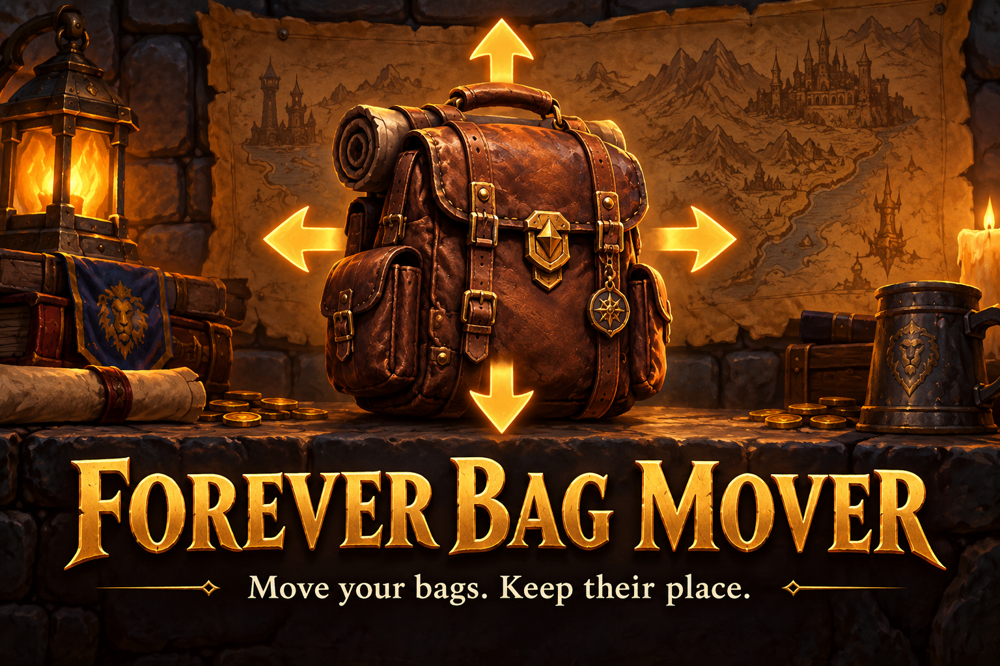
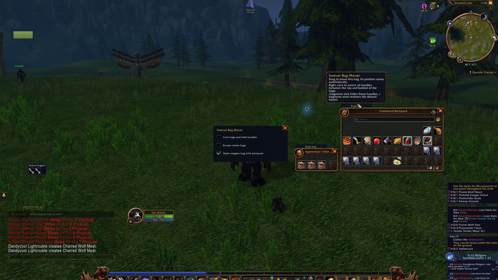

# Forever Bag Mover

AI-generated promotional artwork. The screenshot below shows the actual add-on in game.

Move the normal WoW Forever bags and remember their positions.

This is a beta for WoW Forever 1.60.1, interface 16001.

## Download and install

Download `ForeverBagMover-1.2.5.zip` from [Releases](https://github.com/DeanieBobeanie/ForeverBagMover/releases).
Use that installable ZIP. GitHub's Source code archives contain the development repository.

Close WoW, extract the ZIP and copy `ForeverBagMover` into your Forever client's
`Interface/AddOns` folder. For the current client this is usually
`World of Warcraft/_forever_/Interface/AddOns`. Select the actual client you use.
The resulting path must end in `ForeverBagMover/ForeverBagMover.toc`.
Restart WoW and enable the add-on at character selection.

Open your bags and drag their handles. Use `/bagmove options` for locking, Escape behavior and reagent-bag settings.

Read the [complete controls and troubleshooting guide](ForeverBagMover/README.txt).

## Beta limits

Bag positions cannot be restored during combat when the client restricts the frame. With Escape closing disabled, you may hear the close sound and may need to close bags before Escape opens the game menu.

Checked in WoW Forever on 21 October 2026. The options window opens, both bags open and close, and the combined backpack drag handle moves the backpack and reagent bag together. Combat behavior and persistence across a full game restart still need wider testing.

The automated tests also pass outside WoW. Report the first Lua error and steps to reproduce it in an issue.

## In-game screenshot

The options window, movable combined backpack and reagent bag.
Captured on 21 October 2026. Other installed add-ons are visible in the surrounding UI.

## Help develop it

Read [CONTRIBUTING.md](CONTRIBUTING.md) for setup and test commands.
Bug reports, gameplay checks, code improvements and documentation fixes are welcome.

## Credits and license

DonManDee and Deanie Bobeanie. MIT license.
See [LICENSE](LICENSE). Independent add-on, with no Blizzard endorsement.
